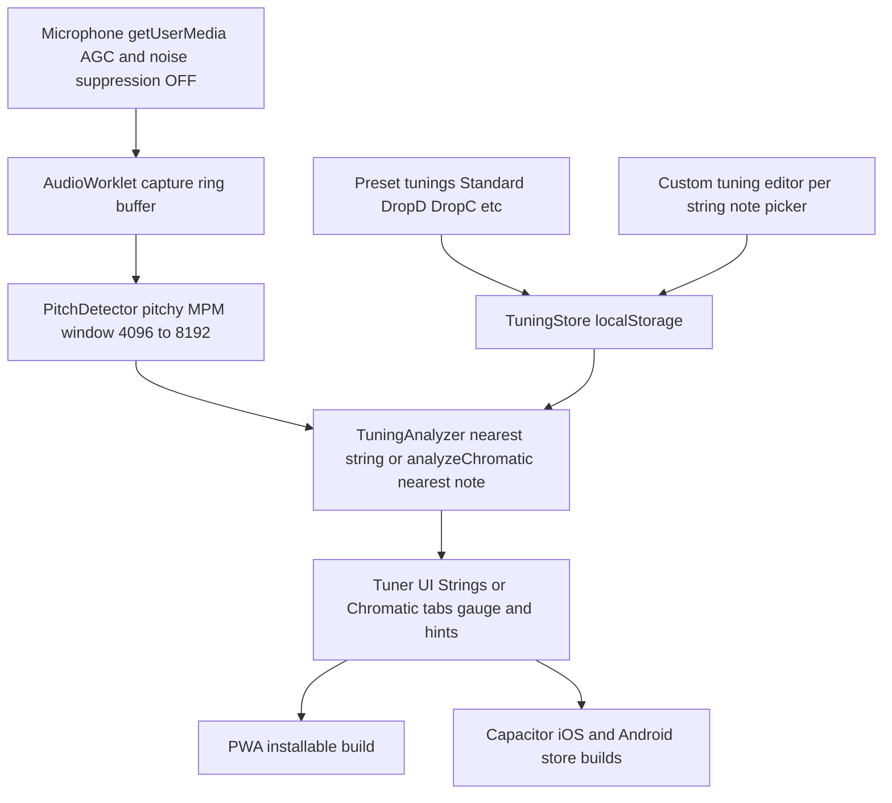

# Anystring — Custom-Tuning Guitar & Bass Tuner (Mobile)

## Status

Steps 1–7 are complete: the app works as an installable PWA with editable
per-string tunings, presets, custom tuning persistence, and live pitch detection
(verified end-to-end with synthetic mic input, including 43.65 Hz F1 in unit tests).

**Chromatic tab:** Strings | Chromatic screen switch. Chromatic uses the same mic
pipeline and `analyzeChromatic` (nearest 12-TET note + cents); no string list or
tuning picker. Session-only screen mode.

Repo-local knowledge graph lives under `docs/knowledge/`. Portable protocol:
`AGENT_PROTOCOL.md` + root `AGENTS.md` (ChatGPT/Codex, Claude, Copilot, Cursor).
Cursor also has `.cursor/rules/knowledge-graph.mdc`. Automation: `knowledge:refresh`
(file inventory), `knowledge:check` (CI job). External Wiki sync is manual only
(no commit/PR automation; Notion/GitHub Wiki on explicit request + read-back).
(`.github/workflows/knowledge-wiki.yml`).

**Store release:** the product is renamed **Anystring** (Anytune is a trademarked
app on both stores) and wrapped with Capacitor 8. Step 8 is done in the repo: the
iOS and Android projects build from the same Vite bundle, permissions, privacy
manifest, icons, and splash screens are configured, and there is an in-app About
sheet plus a published privacy policy. See
`docs/knowledge/areas/native-shell.md`.

Remaining:

- Verify on a real iPhone that the AudioWorklet receives non-zero mic samples inside
  `WKWebView` (WebKit bug 230902). If it does not, add a native `AVAudioEngine`
  source behind the existing `startMicSession` seam.
- Step 9 (real-device testing) — needs a physical phone and instrument; thresholds
  in `src/audio/pitchDetector.ts` and `src/core/tunings/analyzer.ts` may need tuning
  after that.
- Developer accounts, signing, store listings, and submission.
- **Step 10** is in the repo: the tuner starts listening on open, one haptic
  fires when a string first reaches in tune, and that string keeps a check for
  the sitting. Spec below.

**E2E / store assets decision:** Playwright remains the deterministic web e2e
layer (stub mic, permission error copy, reference-tone spy, chromatic/strings).
**Maestro** is the chosen native UI automation for Capacitor iOS/Android
simulators (OS mic allow/deny + shell smoke) — not Appium or Detox. Store phone
screenshots are generated via `npm run screenshots:store` into
`store/screenshots/`. Native pitch-on-simulator is not asserted; real-device mic
verification stays manual.

## Idea review: is it worth building?

Yes. GuitarTuna locks custom/editable tunings behind a paid subscription, and most free tuners only offer fixed presets. A free tuner where you type any note per string (e.g. G#-D#-A#-F for Meshuggah's Demiurge) fills a real gap for non-professional musicians.

One real technical risk to plan for: **very low bass notes** (F1 ≈ 43.7 Hz, and lower for extended-range tunings) are hard to detect. Pitch detection needs a large analysis window (~4096–8192 samples) and a good algorithm (McLeod/YIN, not naive FFT peak). This is solvable and we design for it from day one.

## Platform decision: mobile-only, one codebase, Capacitor

Requirements: mobile app for Android and iOS, one TypeScript codebase, installable **before** the stores, and — top priority — **clean microphone input**.

Chosen approach: **web app (React + TypeScript) wrapped in Capacitor**.

- **Install before stores:** the same build is deployed as a PWA — anyone installs it from a link, today. Capacitor builds produce the store binaries later, no rewrite.
- **Microphone quality (priority #1):** the Web Audio API gives raw PCM samples via `AudioWorklet` and lets us explicitly disable `echoCancellation`, `noiseSuppression`, and `autoGainControl` — mandatory for a tuner, since those filters eat exactly the low-frequency content of bass strings. This works identically in the browser and inside Capacitor's webview (iOS WKWebView supports `getUserMedia`). React Native, by contrast, has _no_ built-in raw audio access and relies on third-party native modules — the riskier option for this app.
- **Gestures:** taps/swipes/drags needed by a tuner work fine with web pointer events.

### Future migration path to React Native (if ever needed)

Kept cheap by an architectural rule: **`src/core/` must be pure TypeScript — no DOM, no React, no browser APIs.** Pitch math, music theory, tuning models, and analysis logic all live there and would port to React Native unchanged. Only `src/audio/` (mic adapter) and `src/components/` (UI) are platform-bound. Enforced with an ESLint import restriction on `src/core/`.

## Stack

- **Vite + React + TypeScript (strict mode)**, `vite-plugin-pwa`
- **Web Audio API + AudioWorklet** for mic capture
- **`pitchy`** (McLeod Pitch Method) for pitch detection
- **Capacitor** for iOS/Android store builds
- **TelemetryDeck** for optional anonymous usage events (no audio, no names). App
  id is `TELEMETRYDECK_APP_ID` at build time. Toggle in About. Decided 5 Oct 2026.
- **`@capacitor-community/in-app-review`** for the native rating dialog; PWA shows
  a store-link banner after three in-tune sessions.
- **`@capacitor/haptics`** for the in-tune pulse on iOS and Android (step 10).
  Web uses `navigator.vibrate` and no-ops where the browser has no vibration.
  Decided 15 Oct 2026.
- **No backend.** Custom tunings stored in `localStorage`. Cloud sync can be added later if ever wanted.
- **Vitest** for unit tests (`jsdom`, `@testing-library/react`, v8 coverage ≥ 95%)

## Code quality rules (ruff/complexipy equivalents for TypeScript)

Ruff and complexipy are Python-only tools; the TypeScript equivalents, enforced via a single `npm run check` command (lint + format check + typecheck + tests) suitable for pre-commit and CI:

- **ESLint** with `typescript-eslint` strict-type-checked config (= ruff role)
- **`eslint-plugin-sonarjs`** with `cognitive-complexity: 10` (= complexipy role), plus `complexity` (cyclomatic ≤ 10), `max-lines-per-function: 50`, `max-depth: 3`
- **Prettier** for formatting (= ruff format)
- Rules documented in `.cursor/rules/` so the agent always follows them
- **SDD + TDD** (Linus Torvalds taste + SOLID) is mandatory for every code
  change: spec in types → failing test → smallest implementation → refactor.
  **Edge-case coverage ≥ 80%** (`src/quality/edgeCases.ts`): every feature
  adds its boundaries to that catalog with an automated test.
  Full agent contract: `docs/knowledge/areas/sdd-tdd.md` and
  `.cursor/rules/sdd-tdd.mdc`. SOLID here is layer boundaries and small
  functions, not class hierarchies.

## Architecture



Project layout (portability rule baked in):

- `src/core/music/` — pure functions: note-to-frequency, frequency-to-nearest-note, cents offset
- `src/core/tunings/` — `Tuning` model, built-in presets, analyzer logic
- `src/audio/` — platform adapter: mic capture, AudioWorklet processor, pitchy wrapper
- `src/components/` — tuner gauge, string selector, tuning editor, preset picker
- `src/state/` — app state (active tuning, detected pitch, auto mode)
- `src/storage/` — localStorage persistence behind a small interface

## Detailed technical plan (junior-developer level)

### 1. Scaffold the project

1. Create `~/Projects/anytune`, run `git init`, move the agent workspace into it.
2. Copy this plan into the repo as `docs/DEVELOPMENT_PLAN.md` (architecture, decisions, and the step-by-step breakdown) so other agents and developers work from the same source of truth. Keep it updated as steps complete; a short `AGENTS.md` at the repo root points to it and to the code-style rule.
3. Scaffold with `npm create vite@latest . -- --template react-ts`, then `npm install`.
4. In `tsconfig.json` confirm `"strict": true`; add `"noUncheckedIndexedAccess": true`.
5. Verify `npm run dev` serves the starter page. First commit.

**Done when:** dev server runs, repo has an initial commit including `docs/DEVELOPMENT_PLAN.md` and `AGENTS.md`.

### 2. Code quality tooling

1. Install dev deps: `typescript-eslint`, `eslint-plugin-sonarjs`, `prettier`, `eslint-config-prettier`, `vitest`.
2. Create `eslint.config.js` (flat config): `strictTypeChecked` + `stylisticTypeChecked`, sonarjs `cognitive-complexity: ["error", 10]`, core `complexity: ["error", 10]`, `max-lines-per-function: ["error", 50]`, `max-depth: ["error", 3]`.
3. Add the portability guard: `no-restricted-imports` rule scoped to `src/core/**` forbidding imports of `react`, anything in `src/components`, `src/audio`, and DOM-touching modules.
4. Add `.prettierrc`, and scripts: `lint`, `format:check`, `typecheck` (`tsc --noEmit`), `test`, and `check` that runs all four.
5. Write `.cursor/rules/code-style.md`: functions small and single-purpose, no `any`, prefer pure functions in `core`, every `core` module gets unit tests, run `npm run check` before finishing any task.

**Done when:** `npm run check` passes on the clean scaffold.

### 3. Music theory core (`src/core/music/`)

Pure math, no dependencies — write tests first.

1. `notes.ts`: define `NOTE_NAMES = ["C","C#","D",...,"B"]` and a `Pitch` type `{ note: NoteName; octave: number }`. Implement `pitchToMidi(pitch): number` (C4 = MIDI 60) and `midiToPitch(midi): Pitch`.
2. `frequency.ts`: `midiToFrequency(midi) = 440 * 2^((midi - 69) / 12)` and its inverse `frequencyToMidiFloat(freq)` (returns a float, e.g. 61.3).
3. `cents.ts`: `centsBetween(actualFreq, targetFreq) = 1200 * log2(actual / target)`. Positive = sharp (loosen), negative = flat (tighten).
4. Tests (Vitest): A4 = 440 Hz, E2 ≈ 82.41 Hz, F1 ≈ 43.65 Hz, G#1 ≈ 51.91 Hz (the Demiurge strings), cents symmetry, midi round-trips.

**Done when:** all tests green, functions documented with one-line JSDoc.

### 4. Audio engine (`src/audio/`)

1. `micStream.ts`: request the mic with `navigator.mediaDevices.getUserMedia({ audio: { echoCancellation: false, noiseSuppression: false, autoGainControl: false } })`. Handle denial with a typed error the UI can render. Create an `AudioContext` and resume it inside a user-gesture handler (mobile requirement).
2. `capture-processor.ts` (AudioWorklet): copy incoming 128-sample frames into a ring buffer; post a `Float32Array` of the latest 8192 samples to the main thread every ~100 ms.
3. `pitchDetector.ts`: wrap `pitchy`'s `PitchDetector.forFloat32Array(8192)`. Return `{ frequency, clarity }`; discard results with `clarity < 0.9` or frequency outside 30–1000 Hz. 8192 samples at 48 kHz ≈ 170 ms — enough periods of a 43 Hz F1 for a stable reading.
4. `usePitch.ts` React hook: starts/stops the pipeline, exposes `{ status, frequency, clarity }`, applies a median filter over the last 5 readings to stop needle jitter.

**Done when:** a debug view shows a stable frequency for a played note, including low bass (test with a recording or tone generator at 43.65 Hz).

### 5. Tuning model (`src/core/tunings/` + `src/storage/`)

1. `types.ts`: `InstrumentString = { pitch: Pitch }`, `Tuning = { id, name, instrument: "guitar" | "bass", strings: InstrumentString[] }`.
2. `presets.ts`: Standard E (guitar), Drop D, Drop C#, Drop C, Half-step down, Standard bass 4/5-string, Drop D bass. Store as data, not code.
3. `analyzer.ts`: `analyze(frequency, tuning)` — find the string whose target frequency is nearest (log scale), compute cents offset, return `{ stringIndex, cents, direction: "tighten" | "loosen" | "in-tune" }` with in-tune = |cents| ≤ 5.
4. `src/storage/tuningStore.ts`: `listCustom() / save(tuning) / remove(id)` over `localStorage` under one JSON key, versioned (`{ v: 1, tunings: [...] }`) for future migrations.
5. Tests: analyzer picks correct string for frequencies between two strings; Demiurge tuning (G#1 D#2 A#2 F1... i.e. per-string custom values) resolves correctly.

**Done when:** tests green; saving/loading a custom tuning survives page reload.

### 6. Tuner UI (`src/components/`, `src/state/`)

1. `src/state/appState.ts`: React context or a tiny store holding `activeTuning`, `autoMode`, current analysis result.
2. `TunerGauge.tsx`: needle/arc showing −50..+50 cents, target note in the center, green when in-tune. SVG, animated with CSS transform (no re-render per frame).
3. `StringList.tsx`: one button per string showing its note+octave; highlights the string the analyzer picked in auto mode; in manual mode tapping selects the target string.
4. `NotePicker.tsx`: opens when the user long-presses/edit-taps a string — pick note name and octave; edits create an unsaved "Custom" copy of the current tuning with a "Save as..." action.
5. `PresetPicker.tsx`: list of built-in presets + saved customs, grouped by instrument.
6. `TuneDirectionHint.tsx`: text like "String 4 (F1): too low — tighten" driven by the analyzer result.
7. Dark theme similar to the GuitarTuna reference; large touch targets; UI strings in a single `strings.ts` module ready for RU/EN localization.

**Done when:** full flow works in a desktop browser with a real guitar or tone generator: pick preset → edit a string to any note → play → needle and hint respond correctly.

### 7. PWA packaging

1. Add `vite-plugin-pwa`: manifest (name, dark theme color, portrait orientation), generated icons, offline-capable service worker (the app has no network calls, so precache everything).
2. Add an install hint UI for iOS Safari ("Share → Add to Home Screen").
3. Deploy the static build (any static host) so the app is installable from a link — this is the "before the stores" distribution.

**Done when:** app installs to a phone home screen and works offline; mic works from the installed app.

### 8. Capacitor shell (store builds)

1. `npm install @capacitor/core @capacitor/cli`, `npx cap init anystring`, add `android` and `ios` platforms.
2. Android: add `RECORD_AUDIO` permission to the manifest. iOS: add `NSMicrophoneUsageDescription` to `Info.plist`.
3. `npx cap sync && npx cap run android` (emulator) and `npx cap run ios` (simulator) — verify mic capture works inside the webview.
4. Store submission itself is a later, separate effort (accounts, signing, listings).

**Done when:** the same web build runs as a native app on both an Android emulator and an iOS simulator with working microphone.

Implemented: `CAP_BUILD=1` switches Vite to a relative base with no service worker,
`npm run cap:sync` stamps iOS versions from `package.json`, rebuilds, and syncs
both projects, and both compile (`xcodebuild` for the simulator, `gradlew
assembleDebug` with JDK 21). Microphone capture inside the webview is still
unverified on real hardware.

**Versioning:** `package.json` `version` + `buildNumber` is the single source.
Android reads it in Gradle; iOS is stamped on `cap:sync`. About on device uses
`@capacitor/app` `App.getInfo()` (installed binary); PWA uses the Vite-bundled
values. A push to `master` runs `.github/workflows/version-bump.yml`, which
applies `npm run version:patch` and pushes the result. `minor` / `major` /
`build` stay manual. Store archives are cut from `master` after that commit.

**Store upload:** GitHub Actions (`.github/workflows/store-release.yml`), not
Fastlane. After CI succeeds on `master`, the workflow uploads the version-bump
commit: Xcode `exportArchive` (`destination: upload`) to TestFlight, and
`gradlew bundleRelease` plus `r0adkll/upload-google-play` to the Play internal
track.

### 9. Polish

1. Test on at least one real Android and one real iOS phone: noisy room, quiet room, low bass strings.
2. Tune thresholds (clarity cutoff, in-tune cents window, median filter length) based on real testing.
3. Ensure `npm run check` is green; review test coverage of `src/core/`.

### 10. Autostart, haptic lock, string checkmarks

One release. Branch `feat/listen-lock` from latest `origin/master`. One PR.
Do not bump `package.json` version; `version-bump.yml` does that on merge.
UI copy stays English. iPhone-only. Do not add iPad.

#### Read first

`docs/knowledge/AGENT_PROTOCOL.md`, `INDEX.md`, then `areas/sdd-tdd.md`,
`areas/audio.md`, `areas/state.md`, `areas/components.md`, `areas/core-tunings.md`.
Implement only through spec → failing test → smallest code. `npm run check`
before the PR. After the new module, `npm run knowledge:refresh`, update the
area pages, `npm run knowledge:check`.

#### Already decided

- In tune means `|cents| ≤ IN_TUNE_CENTS` (5), on the **displayed** analysis
  after `useStableAnalysis`. Do not invent a second threshold.
- Checkmarks are for this sitting only. No new `localStorage` key. They reset
  when the tuning identity changes: `tuning.id` plus the MIDI of every string,
  so a draft edit clears them too.
- A check stays on after the string leaves in-tune. It means “reached in tune”,
  not “is in tune right now”.
- The haptic is a rising edge. It fires when a string enters in-tune, stays
  quiet while that string is held there, and may fire again only after the
  displayed direction leaves in-tune. The check does not clear on that re-arm.
- Chromatic mode has no string list: no checks, no haptic.
- Only the analyzed `stringIndex` is marked. Two strings on the same pitch do
  not both get a check.
- The reference-tone pitch gate stays in front of this. A preview tone must
  not mark or pulse a string.
- Autostart is not a preference. There is no About toggle in this release.
- Mic constraints do not change: AGC, noise suppression, and echo cancellation
  stay off. The pitch window stays 8192.
- Haptics dependency is `@capacitor/haptics` (see Stack). Do not add another
  vibration library.

#### Autostart

Pure predicate, unit-tested, then called from the mic hook:

```ts
type AutoStartInput = {
  status: 'idle' | 'starting' | 'listening' | 'error'
  stoppedByUser: boolean
}

function shouldAutoStart(input: AutoStartInput): boolean
```

True only when `status === 'idle'` and `stoppedByUser` is false.

- On mount, if `shouldAutoStart`, call the existing `start` once.
- `stoppedByUser` is memory only. Stop sets it. It resets when the page loads
  again, so the next open listens.
- Do not start again after Stop until that reload.
- `starting` or `listening`: do nothing. No second `getUserMedia`.
- `error` (denied, missing mic): do nothing. The existing error copy and the
  Start button stay. No retry timer.
- iOS may reject `getUserMedia` without a user gesture on the first launch.
  That rejection is the existing error path. Leave Start on screen. Do not
  loop. Do not add a native `AVAudioEngine` in this PR.
- Background resume already restarts an active session. It must not restart a
  session the user stopped.

#### String lock

New pure module `src/core/tunings/stringLock.ts` plus `stringLock.test.ts`.

```ts
type StringLockState = {
  checked: readonly number[]
  holding: number | null
}

type StringLockInput = {
  tuningKey: string
  screen: 'strings' | 'chromatic'
  stringIndex: number | null
  inTune: boolean
}

type StringLockStep = {
  state: StringLockState
  pulse: boolean
}

function stepStringLock(state: StringLockState, input: StringLockInput): StringLockStep
```

`tuningKey` is `id` plus MIDI numbers. A key change returns empty `checked`,
`holding: null`, `pulse: false`.

Otherwise:

| Input                                | checked              | holding    | pulse |
| ------------------------------------ | -------------------- | ---------- | ----- |
| chromatic, or `stringIndex === null` | unchanged            | `null`     | false |
| in tune, index already `holding`     | unchanged            | same index | false |
| in tune, index not `holding`         | add index if missing | that index | true  |
| not in tune                          | unchanged            | `null`     | false |

Wire the step from tuner state off the displayed string analysis. Call the
platform pulse only when `pulse` is true. One call per step, not per render.

#### Haptic adapter

`src/platform/hapticPulse.ts`. Native: `Haptics.impact` light. Web:
`navigator.vibrate(20)` when the function exists. Missing API or a thrown
native call: return without throwing. Core must not import this module.

`npx cap sync` so the plugin is in the iOS and Android projects. Commit that
sync output (`Package.swift`, Android Gradle includes).

#### Checkmark UI

`StringList` gains `checked: readonly number[]`. The button name stays
`1 E2` until that string is checked, then `1 E2, in tune`. The note label
stays. Add a green check that is not the only signal (the name change is).
Do not replace the active or manual highlight. Chromatic screen renders no
string list, so it needs no check UI.

Copy for the suffix lives in `src/components/strings.ts` (`in tune` already
exists as `UI.inTune`).

#### Edge cases

Add these to `src/quality/edgeCases.ts` and name a test with each id:

| Id                     | Expected                                                     |
| ---------------------- | ------------------------------------------------------------ |
| `EC-autostart-idle`    | idle and not stopped → start                                 |
| `EC-autostart-stopped` | after Stop → do not start                                    |
| `EC-autostart-busy`    | starting or listening → do not start again                   |
| `EC-autostart-denied`  | error → do not start again                                   |
| `EC-lock-first`        | first in-tune on a string checks it and pulses               |
| `EC-lock-hold`         | staying in tune does not pulse again                         |
| `EC-lock-rearm`        | leaving in tune, then returning, pulses again; check remains |
| `EC-lock-switch`       | a different string can check and pulse on its own            |
| `EC-lock-chromatic`    | chromatic changes nothing and does not pulse                 |
| `EC-lock-silent`       | null string index clears the hold and does not pulse         |
| `EC-lock-tuning`       | a new tuning key clears checks                               |
| `EC-lock-duplicate`    | only the analyzed index is checked                           |
| `EC-haptic-missing`    | no `vibrate` and no native plugin → no throw                 |

#### Tests that will lie if left alone

Playwright currently expects **Start tuning** on first paint, then clicks it.
After this change a granted stub mic is already **Stop**. Update the app
specs (`e2e/tuner.spec.ts`, `stop-tuning.spec.ts`, `mic-permissions.spec.ts`,
`background-resume.spec.ts`, `custom-tuning.spec.ts`, `reference-tone.spec.ts`,
`review-prompt.spec.ts`, `landing.spec.ts`, `e2e/smoke.spec.ts`).
`e2e/store/screenshots.spec.ts` must not click Start if that click now means
Stop; the framed shots should still show a listening tuner.

Denied-mic specs still expect Start and the error, and they must not see a
retry storm.

#### Out of scope

A4 calibration, numeric Hz readout, localization, a haptics toggle, persisting
checks, autostart on the marketing page, store screenshots of the checkmark,
and any backend.

#### Done when

- `npm run check` is green, including the new edge-case ids.
- Opening the tuner with a granted mic shows Stop without a tap.
- Stop stays stopped until reload.
- A denied mic shows the current error once.
- On the Strings screen, the first stable in-tune locks a check on that
  string and one haptic pulse; holding the note does not pulse again.
- Changing preset or editing a string pitch clears the checks.
- Chromatic does neither.
